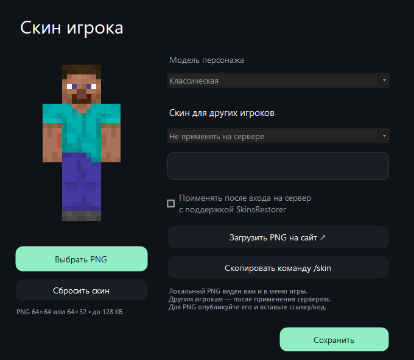

# LARP Client — полная сборка

Готовый клиент Minecraft 1.21.11 / Fabric 0.20.1 для Windows x64: лаунчер с новым меню, игровые файлы, моды, библиотеки, ресурсы и встроенная Java 21.

## Скачать весь клиент

**[Скачать полный LARP Client ZIP](https://github.com/sunakle/larp-client/archive/refs/heads/main.zip)**

1. Скачайте ZIP и распакуйте его целиком в отдельную папку, например D:\Games\LARP.
2. Откройте распакованную папку larp-client-main и запустите LARP Client.exe.
3. Укажите никнейм, выберите память и нажмите «ИГРАТЬ».

Устанавливать Java или другой Minecraft-лаунчер не требуется. EXE запускается вместе с соседними папками game и runtime. Не переносите его отдельно.

Требования: Windows x64, .NET Framework 4.x, память для выбранного объёма Java и работы Windows. Лаунчер определяет физическую ОЗУ, показывает свободную память и позволяет выбрать от 2 ГБ до объёма ОЗУ за вычетом 2 ГБ для Windows; фиксированного потолка 12 ГБ нет. Встроенная Java используется независимо от системной.

## Ресурспак и конфиг larp-config

Оба файла уже входят в полный ZIP клиента. Можно скачать их отдельно:

| Файл | Ссылка |
| --- | --- |
| Совместимый ресурспак 1.21.11, около 72 МБ | [Скачать ZIP](https://github.com/sunakle/larp-client/raw/refs/heads/main/game/resourcepacks/LARP-Resourcepack-1.21.11.zip) |
| Конфиг larp-config.json | [Открыть / сохранить JSON](https://github.com/sunakle/larp-client/raw/refs/heads/main/game/config/larp-client/profiles/larp-config.json) |

Ресурспак лежит в game/resourcepacks. В настройках ресурсов Minecraft включите **LARP-Resourcepack-1.21.11.zip**; оставьте активным только его и стандартные ресурсы. ZIP самого пакета распаковывать не нужно.

Конфиг лежит в game/config/larp-client/profiles/larp-config.json. В менеджере конфигов LARP выберите **larp-config** и примените его. Share-код не нужен. Пресет содержит настройки 143 модулей, 30 из них включены; он не применяется автоматически при скачивании.

В рабочий ресурспак объединены части 20 исходных пакетов. Дубли, альтернативные текстуры и 8 неподдерживаемых исходных пакетов в рабочий ZIP не включены. [Отчёт CSV](docs/resourcepacks/REPORT.csv), [полный отчёт JSON](docs/resourcepacks/REPORT.json). Загрузка пакета в Minecraft 1.21.11 с LARP проверена; отдельные эффекты во всём мире не тестировались.

## Состав

| Путь | Содержимое |
| --- | --- |
| LARP Client.exe | Собранный лаунчер с новым меню и иконкой |
| launch-config.json | Конфигурация Minecraft и Fabric с относительными путями |
| game/versions | Minecraft 1.21.11 |
| game/libraries | Fabric Loader и игровые библиотеки |
| game/mods | LARP Client 2.2.6 и Fabric API |
| game/assets | Индекс и объекты игровых ресурсов |
| game/resourcepacks | Совместимый объединённый ресурспак |
| game/config/larp-client/profiles | Общий пресет larp-config.json |
| game/natives | Нативные библиотеки Windows |
| runtime | Полная встроенная Java 21 |
| assets | Логотип и значки приложения |
| source | Исходники лаунчера, Skin Bridge и сценарии сборки |

В публикацию не включены сохранённые аккаунты, токены, миры, список серверов, скриншоты, история команд и журналы. При первом запуске создаётся чистый локальный профиль Player; никнейм можно изменить.

Лаунчер использует локальный профиль. Microsoft-аутентификация не реализована; серверы с проверкой лицензии требуют отдельного входа Microsoft.

## Скины

Откройте **«Скин и серверы» → «Выбрать PNG»**. Поддерживаются 64×64 и 64×32, до 128 КБ. Выберите классическую модель или тонкие руки и нажмите «Сохранить». Предпросмотр появится в лаунчере; при запуске отдельный LARP Launcher Skin Bridge передаст выбор встроенному Skin Changer, в том числе модели на главном экране игры.

### Чтобы скин видели другие игроки

Локальный PNG меняет отображение на вашем клиенте. Для серверного скина нужен сервер с **SkinsRestorer**, доступной командой /skin и соответствующими разрешениями.

1. В окне скина выберите «По никнейму скина» либо «По ссылке или коду SkinsRestorer».
2. Укажите никнейм, прямую HTTPS-ссылку на скин или код skinsrestorer-axolotl:// (до 190 символов).
3. Для своего PNG кнопка «Загрузить PNG на сайт» открывает официальный загрузчик SkinsRestorer. Опубликуйте там PNG и вставьте полученный адрес/код в лаунчер. Загрузка на сайт выполняется пользователем, автоматически файл никуда не отправляется.
4. Включите «Применять после входа» и сохраните. После подключения мост ждёт появления команды skin у сервера, в том числе после авторизации /login, и один раз отправляет запрос.
5. Либо скопируйте готовую команду кнопкой и выполните её в чате самостоятельно.

На сервере без такой поддержки локальный клиент не может назначить видимый всем скин. Успех запроса определяется ответом сервера; мультиплеерная проверка этой функции на реальном сервере не выполнялась.

Документация: https://skinsrestorer.net/docs/features/skin-upload

## Пересобрать лаунчер

~~~powershell
powershell.exe -NoProfile -ExecutionPolicy Bypass -File .\source\build-launcher.ps1
~~~

Сборка требует Windows .NET Framework 4.x. Исходники игрового мода не входят в поставку: моды находятся в game/mods в виде JAR. Три PNG логотипа LARP заменены новым знаком; файлы классов исходного мода не менялись. Дополнительный мод LarpSkinBridge-1.0.0.jar имеет собственные исходники в source/skin-bridge и отдельную лицензию MIT. Лицензионные файлы библиотек и встроенной Java сохранены в их исходных местах.

## Проверка комплекта

~~~powershell
& ".\LARP Client.exe" --check
~~~

Результаты находятся в verification.json: 24 проверки лаунчера и 11 проверок Skin Bridge, сборка без предупреждений, снимки обычных и отключённых кнопок. В настоящем игровом запуске журнал подтвердил загрузку главного меню и успешное применение launcher.png через Skin Changer; игра закрылась с кодом 0. Снимок игрового окна получить не удалось, интеграция проверена по журналу. Миры и мультиплеер не тестировались.

~~~powershell
powershell.exe -NoProfile -ExecutionPolicy Bypass -File .\source\tests\run.ps1
powershell.exe -NoProfile -ExecutionPolicy Bypass -File .\source\skin-bridge\build.ps1
~~~

Для пересборки Skin Bridge сначала один раз запустите игру: Fabric создаст intermediary-кэш. Также можно передать build.ps1 параметр -MinecraftJar с путём к client-intermediary.jar. Сценарий использует встроенные javac и jar и выполняет 11 проверок команд.
