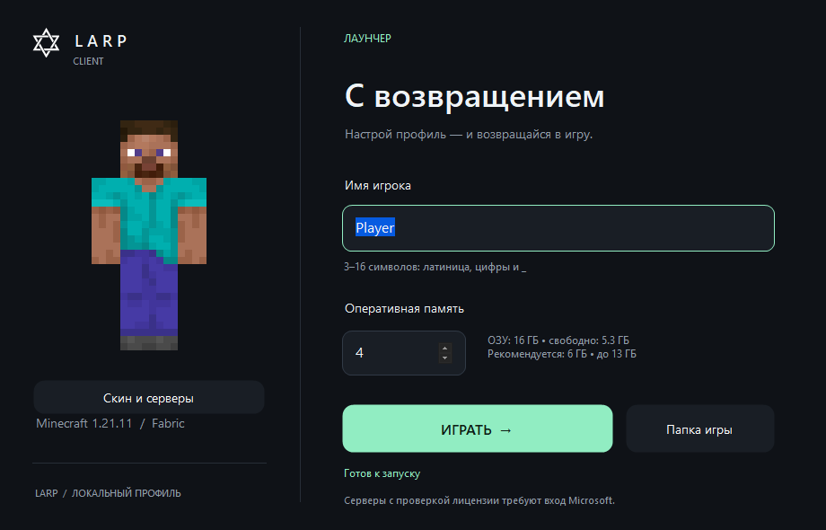

# LARP Client — полная сборка

Готовый клиент Minecraft 1.21.11 / Fabric 0.20.1 для Windows x64: лаунчер с новым меню, игровые файлы, моды, библиотеки, ресурсы и встроенная Java 21.

## Скачать весь клиент

**[Скачать полный LARP Client ZIP](https://github.com/sunakle/larp-client/archive/refs/heads/main.zip)**

1. Скачайте ZIP и распакуйте его целиком в отдельную папку, например D:\Games\LARP.
2. Откройте распакованную папку larp-client-main и запустите LARP Client.exe.
3. Укажите никнейм, выберите память и нажмите «ИГРАТЬ».

Устанавливать Java или другой Minecraft-лаунчер не требуется. EXE запускается вместе с соседними папками game и runtime. Не переносите его отдельно.

Требования: Windows x64, .NET Framework 4.x, память для выбранного объёма Java и работы Windows. Лаунчер позволяет выделить игре 2–12 ГБ. Встроенная Java используется независимо от системной.

## Состав

| Путь | Содержимое |
| --- | --- |
| LARP Client.exe | Собранный лаунчер с новым меню и иконкой |
| launch-config.json | Конфигурация Minecraft и Fabric с относительными путями |
| game/versions | Minecraft 1.21.11 |
| game/libraries | Fabric Loader и игровые библиотеки |
| game/mods | LARP Client 2.2.6 и Fabric API |
| game/assets | Индекс и объекты игровых ресурсов |
| game/natives | Нативные библиотеки Windows |
| runtime | Полная встроенная Java 21 |
| assets | Логотип и значки приложения |
| source | Исходники лаунчера и сценарии сборки |

В публикацию не включены сохранённые аккаунты, токены, миры, список серверов, скриншоты, история команд и журналы. При первом запуске создаётся чистый локальный профиль Player; никнейм можно изменить.

Лаунчер использует локальный профиль. Microsoft-аутентификация не реализована; серверы с проверкой лицензии требуют отдельного входа Microsoft.

## Пересобрать лаунчер

~~~powershell
powershell.exe -NoProfile -ExecutionPolicy Bypass -File .\source\build-launcher.ps1
~~~

Сборка требует Windows .NET Framework 4.x. Исходники игрового мода не входят в поставку: моды находятся в game/mods в виде JAR. Три PNG логотипа LARP заменены новым знаком; файлы классов не менялись. Лицензионные файлы библиотек и встроенной Java сохранены в их исходных местах.

## Проверка комплекта

~~~powershell
& ".\LARP Client.exe" --check
~~~

Результаты подготовки полной сборки находятся в verification.json. Запуск игры и мультиплеер после подготовки этой копии не проверялись.
